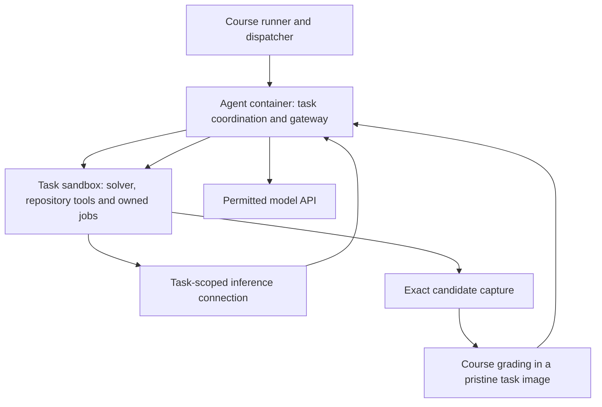

# Architecture: a dependable environment for autonomous engineering

The architecture exists to support a model that investigates, learns, edits,
checks and continues with a useful understanding. It should make the real state
of that work visible and dependable while leaving investigative choices to the
model. MODEL-EXPERIENCE.md owns the current behavioral policy; this guide explains
how responsibilities are divided, why those boundaries matter and where to inspect
the implementation.

## Why an ordinary loop

An investigation naturally consists of requests, complete model responses,
operations and observations. Keeping that progression explicit makes it possible
to inspect the exact request that led to a decision and the real operation that
followed. Small records and pure rendering functions make the working view and
provider serialization testable without hiding behavior behind a framework.

We do need state for live jobs, immutable history, model ownership, uncertain
operations, captured candidates and provider accounting. Those records protect
real distinctions. A process can still be running when its tool returns; a grade
can describe a previous patch while current source has changed; an interrupted
inference may have incurred a charge. Removing those distinctions would make the
model's picture of the environment unreliable.

A new abstraction should own a concrete responsibility that is difficult to express
correctly in the existing design. It should not create a second workflow merely
to make the implementation appear organized. Prefer one understandable path over
dormant modes and competing representations of the same investigation.

The boundaries below describe the current implementation. They explain where
operational facts are established, without requiring a separate abstraction for
each responsibility. [AGENTS.md](AGENTS.md#choose-a-correction-that-explains-the-improvement)
explains how to judge changes to this organization.

## Responsibilities and observable boundaries

| Responsibility | What it owns | Why the boundary matters |
| --- | --- | --- |
| Investigation | Current owner, action/control flow and response to findings | The model should continue one engineering problem rather than restart disconnected attempts |
| Context | Immutable evidence, selected presentation and model-authored understanding | Relevance can change without rewriting observations or losing retrieval |
| Execution | Actual repository operations, process state and output capture | A proposed or pending action must not be presented as completed work |
| Inference | Provider-specific requests, validated responses, continuation and usage | Transport or model differences must not silently change what actions execute |
| Grading | Exact candidate capture, assessment identity and finalization | The reported outcome must refer to the artifact the course assessed |
| Coordination | Task acquisition, isolated workers, shared control and reporting | Parallel tasks must not share mutable investigations or lose owners |

The model interprets observations and chooses what to investigate. The runtime
establishes operational facts. A summary is not an alternative authoritative
execution log, and a receipt does not decide the semantic correctness of a fix.

These distinctions must remain truthful in behavior; they do not require a
separate file, prompt fragment or abstraction for every responsibility. The map
below locates the current implementation rather than prescribing its structure.
Consolidate overlapping components when one existing path can preserve the
necessary distinctions. Judge the resulting execution and model-facing request,
not the number of named architectural boundaries.

## Execution locations and data flow

The agent container has dispatcher access and API credentials. The solver is
deployed into each task sandbox so its commands operate on the real repository.
Inference passes through the task-scoped gateway rather than requiring the
repository container to reach the course API directly. Deployment RPC is plumbing;
it is not a substitute model-facing coding-tool layer.

Use the returned workdir. Do not assume `/app`, the developer's checkout, or an
agent-container shell is the task repository. Keep the agent's runtime imports
isolated from repository commands: a task may have its own `src` package and a
different Python environment. Interpreter/bootstrap selection must not alter how
the task's own commands resolve dependencies.

Complete outputs, archive records, operation receipts and runtime scratch files
live outside the task repository, normally under owned `/tmp/a3` storage in the
sandbox. This prevents them from becoming accidental candidate files. Export
required evidence before finalization destroys the sandbox. External evidence
retention is part of lifecycle correctness, not a reason to pollute the patch.

## One request-to-observation cycle

The investigation chooses the current owner/profile and renders the accepted
working view with original instructions, tool schemas and essential execution
state. Provider presentation applies the verified profile's reasoning/message
rules. The gateway retains the actual outbound request and raw response evidence.

Only a complete, validated response authorizes an action batch. Tool arguments,
control exclusivity and identities are checked before execution. Repository tools
operate in the sandbox and retain full observations. The context archive records
the exchange, and the next request carries usable results plus current state.
Control calls may end an investigation, replace context or grade
a candidate; each has its own explicit transition.

When debugging, trace this entire cycle. A renderer can correctly compute a line
count but omit it from the delivered result. A validator can reject a malformed
batch after a logger recorded its intended action. A provider field can be
archived but omitted from serialization. Inspect the boundary that actually
consumes the value before claiming the model received it or an operation ran.

## Context architecture: originals and the working view

Immutable history and the selected working presentation are separate. The archive
retains complete exchanges and saved evidence. The working view determines what
detail appears in the next request and contains the model's current continuation
summary. This separation permits genuine replacement without destroying the
ability to correct an interpretation.

`context.py` renders older tool result bodies as receipts outside a fixed recent
window, using existing result metadata and immutable archive paths. This changes
only presentation, keeps call/result pairs and assistant messages intact, and
does not mutate the accepted view or execute tools. Ordinary requests, recovery
rendering and presentation-size inventories apply the same rule; recovery may
add its existing temporary reductions. Fresh tool observations enter the recent
window normally. MODEL-EXPERIENCE.md specifies the window and receipt policy.

`compact_context` selects a complete boundary and produces one replacement account.
It preserves original user instructions and current runtime state independently
of the summary. Search and exact reads recover prior evidence when needed. Notes
are ordinary files rather than another automatically injected memory channel.
Only `compact_context` and `search_history` are context controls in the production
menu. The detailed continuation guidance belongs to the compact tool schema;
other prompts refer to it. Historical archive compatibility must not add alternate
model-facing view editors or a retain-context action.

Provider capacity evidence distinguishes advertised total/output maxima from
observed input capacity under a particular allocation. Preserve the route,
allocation and original response supporting a learned boundary. An unknown course
default stays unknown; subtracting advertised maximum output from total context
does not discover that default. These facts refine the maintenance scheduler,
not ordinary input admission or per-response spending limits.

`maintenance.py` detects an 80% crossing of the applicable evidenced input
boundary. It requires the same owner to compact, with read-only archived-evidence
inspection available; it does not choose relevance or evict detail itself.
Voluntary compaction uses the same mechanism before a threshold crossing.
Default inference requests continue to omit `max_tokens`.

An actual provider rejection can initiate a restricted temporary projection so
the owner can author a replacement. Commit of the new view ends that temporary
projection, while the rejection episode remains observable until an ordinary
request is accepted. Keep view replacement, provider acceptance and useful
continuation distinct in code, logs and tests. A smaller recovery request is not
proof of useful model-authored compaction. A secured passing candidate proceeds
to its direct memory note without threshold maintenance; actual capacity
rejection remains actionable in that phase.

Both maintenance and recovery preserve the full system foundation and deliver an
attributed immediate request through the compatible carrier. Test the resulting
roles, messages, schemas and next action. A state field saying “maintenance
complete” does not establish instruction continuity or useful continuation.

## Inference and uncertain operations

The course API is the contract. It exposes logical model aliases and metadata,
and the solver speaks only that interface: `discover_profiles` reads the course
`/v1/models`, and every request uses a course alias and fields the course
advertises. Development may substitute other models behind the same interface
through the course reroute (`dev/course_origin.py`), never inside `src/`. Do not
infer model identity from a matching price or assume a substitute is
course-equivalent without checking it against the course API.

Provider-native reasoning, visible attributed evidence and archived-only fields
have different semantics. `provider_policy` and `present_messages` implement the
verified replay rules. Use the same presentation when measuring input and sending
it. Otherwise an estimate may count information the model never receives, or a
change in message placement may silently alter continuation. Preserve unsupported
native fields in the archive without inventing provider support.

Validate response termination, identity, action assembly and usage attribution as
one normalized response boundary. Partial stream fragments cannot authorize
execution. Independently valid usage can survive a rejected action; a nominal
HTTP rejection cannot erase evidence that generation already happened.

Distinguish definite pre-generation rate limits from interruption or uncertain
completion. A known non-generation rejection can honor retry guidance. Lost RPC
delivery may be recoverable through operation lookup without repeating inference
or effects. A pending operation must settle before a new action assumes its
outcome. Do not simplify uncertainty into automatic replay of a mutation or grade.

Shared accounting includes both owners, the automatic expert review, maintenance,
notes and billed retries. `RunControl` owns upward-only task spending ceilings,
monetary admission and exact decimal settlement. It derives the pool for unfinished
tasks from completed charges and outstanding exposure, rather than moving money
between per-task reservations. `Gateway` accepts the shared `RunControl` and task
identity, with no separate local monetary limit. It checks admission before
inference. The course can impose its external time limit; the harness has no local
time stop. Shared admission uses the full declared monetary ceiling without a
fixed reserve. Uncapped admitted responses can exceed that ceiling; the course
may enforce its own stop before all outstanding work settles.
Unknown charges count at their full reservations against the task and
shared spending. Explicitly unbudgeted development has no monetary ceiling.
MODEL-EXPERIENCE.md specifies the allocation formula and sampling of current state.
Admitted responses are uncapped; exposure reservations never become output limits.
Keep course-equivalent usage separate from actual backend charges.

## Expert review and independent recovery input

The initial owner's first unsuccessful actual grade claims one task-scoped expert
review, including an end-of-attempt settlement grade. It uses the ordinary
inference/accounting boundary with no tools and no ownership change. Later grades,
unchanged receipts, recovery and context replacement cannot reset the claim.
Transport uncertainty and unusable advice retain their actual outcomes and usage;
they do not authorize an unaccounted second review.

The review bundle uses the complete public task, exact captured patch and grade,
plus a 30-context-line diff reconstructed from the base in a disposable Git index.
It includes command identities/latest observed states, the last four command
outputs, and saved observations from the latest eight distinct repository files
read, paired with their original-base content where available. Individual selected
observations above 16,000 bytes are explicitly excerpted into first/last portions
with omitted counts and complete-selected-byte identity. A file observation hash
is not a patch hash or proof that current source matches it. No owner narrative,
semantic relevance guess or invented missing evidence enters the bundle.

The review separates engineer notes from an independent-design brief. Notes can
discuss the failed candidate; the brief is restricted to public contract and
original-source orientation. Both remain interpretations. The continuing owner
receives notes; recovery receives only a usable brief. Shared investigation skills
are assembled once per owner/reviewer system request, not copied into every prompt. They own
concrete guidance on caller compatibility, test conditions and expected results,
state/lifecycle distinctions, causal investigation, environment attribution and
candidate-aware advice. Role prompts add only their distinct responsibility;
failed-grade events give a short immediate continuation rather than repeating
the shared guidance. Context schema guidance owns the exact unresolved invocation and
evidence that a continuation must preserve. These instructions guide engineering
choices; they add no mandatory testing stage, per-requirement form or output cap.

Recovery preparation removes the outgoing owner from the exposed work environment.
The retained candidate, grade records and original evidence live in private runtime
storage for finalization and analysis. Recovery receives a private repository at
the source base and a fresh owned evidence root. Its source, Git metadata, tools,
history index and current-state rendering must not reference the failed attempt.
Development-only replay is implemented outside the submitted runtime; its
experimental packaging and evidence boundaries are described in DEVELOPMENT.md.

This isolation is a lifecycle guarantee for owned repository, runtime and scratch
paths. It is not a new operating-system security boundary against arbitrary
hostile writes elsewhere in the container. Check ordinary source, output, memory,
job and historical-path routes when verifying that failed-design material has not
leaked into recovery. Keep the exact earlier-candidate artifacts private
without dropping their accounting or developer evidence.

## Grading and artifact identity

Capturing a patch is a boundary operation. It must include intended source changes
and new files and retain the exact bytes independently of later repository edits.
Timestamp/index behavior matters because an apparently clean diff can otherwise
omit a real change. Capture failures are explicit failures, not empty successful
candidates.

The official grade identifies the captured candidate. Preserve that identity
through feedback, repair, expert review, fresh recovery and finalization. Failed
evaluation while investigating leaves the current owner active. An explicit
`end_attempt(reason="...")` ends that investigation and invokes runtime candidate
settlement. If its completed result is unsuccessful, ownership can transfer once
to standard recovery while shared execution still admits work. Runtime failure or
cancellation is not that transition. Preserve exact outgoing graded and ungraded
bytes privately before preparing an isolated workspace at the original source base.
The initial owner's patch and investigation are not exposed to recovery.

Before owner tools run, workspace preparation retains a private snapshot of the
complete original task directory, including Git metadata, legitimate ignored
files and installed dependencies. Recovery restores that snapshot at the same
original workdir so editable imports, absolute paths and prepared dependencies
continue to resolve. Snapshot identity establishes supplied-image bytes; it does
not newly verify a dependency commit whose Git object was absent in the image.
The top-level task base remains separately verified. Restore verification compares
candidate bytes and digest with the intake capture, not with an assumed empty
Git diff: supplied tracked changes and untracked inputs belong to the original
state too. If intake snapshotting fails, initial solving remains available but
fresh recovery is unavailable; the runtime records that preparation failure.

The runtime confirms that the initial evidence has been exported privately before
removing exposed history, requests, outputs, candidate patches, notes, seed files
and prior-memory material. Recovery uses a fresh owned evidence root. An intake
inventory of /tmp and HOME supports removal of newly created scratch entries;
pre-existing scratch and dependency files are retained. This does not promise to
roll back arbitrary modifications to pre-existing external files. Failure to
preserve or restore the required original state is a preparation failure, not
permission to use the outgoing workspace as though it were a clean base.

The selected final candidate is the latest actually graded candidate, distinct
from current mutable files. `evaluate_candidate` captures and grades current source during investigation.
`end_attempt` settles the current source before ending: a new nonempty patch is
graded, exact previously evaluated bytes reuse their receipt, and the owner then
writes its memory note, passed or not. An unchanged empty base without a prior grade ends with no
candidate or recovery. Capture and evaluation-preparation failures before grading
return actionable feedback to the active owner. An uncertain grade terminates as
an infrastructure outcome without automatic replay. Neither is a successful
settlement or model give-up event. The outgoing graded
candidate is retained until recovery obtains a new actual grade. Every completed
recovery grade selects its captured bytes, including partial results; aggregate
counts do not rank candidates. The earlier candidate stays private. There is no
candidate-selection control and no fallback regrading between recovery evaluations.
The course's latest evaluation and the selected final candidate therefore advance
together. Ending recovery settles current source and finalizes the latest graded
candidate. Shared-stop handling
preserves the selected captured candidate without starting an evaluation of
ungraded source. Monetary exhaustion is enforced at the next inference admission,
not by supervisor cancellation: the last admitted response finishes its actions.
Local allowance and platform funding refusal share settlement after owned-process
cleanup. Capture current source and grade new nonempty bytes once, reuse exact
receipts, and keep the selected candidate on an empty base or capture/preparation
failure. A secured pass or ended owner is not reopened; a historical receipt does
not select older bytes. This path never starts recovery. Neither finalization path
needs another model call, but the external deadline
can still interrupt a course operation; do not claim atomic finalization or replay
an uncertain grade.
Final working-tree archives identify an exact matching grading receipt when one
is known; later ungraded bytes remain separate from the selected final artifact.
Task release is a runtime responsibility even when sandbox startup, capture,
job cleanup or evidence archiving fails. Finalization submits only selected
captured bytes; with no grade it supplies an empty patch and calls the course's
`done()`. The course may perform its empty-patch evaluation before releasing the
slot. After `continue()`, empty submission bytes retain the course's previous
actual result without accidentally evaluating abandoned edits. Registered grading
already in flight must settle before `done()`; its completed receipt advances the
selected candidate. Unknown external grading is never replayed or claimed closed.
Pending inference and incomplete auxiliary evidence delivery remain recorded but
do not themselves block task release. The shared course deadline remains the
ultimate shutdown authority.

Candidate transport uses a saved snapshot manifest and bounded reads through the
existing sandbox execution interface. The receiving boundary verifies byte count,
whole-transfer digest and captured-patch digest before accepting the candidate;
large patches therefore do not depend on fitting a bootstrap command's output
limit. A failed copy of an already graded patch into review evidence gets one
retry of those same bytes, never a repeated evaluation. Definite pre-generation
rate limits honor Retry-After while monetary admission and external cancellation
permit work. Declared platform time is metadata, not a local retry cutoff.
Transient transport failures and HTTP 408/429/502/503/504 on the read-only
accounting-state request retry with delays of 1, 2, 4, then at most 5 seconds.
Inference stays paused until authoritative state returns. External stop requests
interrupt backoff; malformed state and explicit accounting-integrity errors remain
terminal. This does not replay inference or evaluation requests.

When an owner ends through a pass or `end_attempt`, `begin_note` opens the
restricted memory phase and `finish_task` writes the cross-task record. The same
monetary allowance continues through this phase and any later recovery;
no local task or submission deadline is enforced.
Restricted historical retrieval and context maintenance remain available; source
edits and new grading do not reopen the completed repair. The settlement paths
above also govern stops during this phase. MODEL-EXPERIENCE.md owns their complete
behavioral contract.

The grader restores original tests, applies its test patch and runs in a pristine
container. Local fixture edits, installed packages and running services do not
travel with the candidate. This is why a changed local pass cannot establish
compatibility and why a setup failure must be distinguished from an assertion
failure. Original-test restoration is an execution fact, not a prohibition on
explicitly required interface migrations: local adaptations may check the new
interface, while source still must satisfy the public contract. Unknown grading outcomes are not automatically re-executed.

## Course deployment contract

The retained course revision is
`7562690a4ad9de0d827b0f73e6ca69ea92c09cfd`; `upstream.json` records provenance
and original-file hashes. The handout and retained source establish the inspected
contract. The course supplies its own infrastructure for uploaded submissions;
changing our local scaffold does not ship a feature.

| Boundary | Required consequence |
| --- | --- |
| Entry | Keep `src.agentic_loop.Agent(dispatcher).run()`; all submitted behavior must reside in `src/` |
| Dependencies | The agent image is Python 3.11 slim; task runtimes differ. Our implementation uses stdlib and must work offline |
| Network | Task and grading containers have no general internet. Honor `CS2680_BASE_URL`, credentials and model metadata supplied at the agent boundary |
| Storage | Installed `/madsOpt` is read-only. Use owned writable runtime paths and preserve dispatcher handshake files |
| Logs | Send model and tool events through `dispatcher.logger(k)`; private archives supplement course reporting |
| Concurrency | Preserve isolated task owners and repositories. The inspected course supports at most five live tasks and three concurrent gradings |
| Shutdown | Respect the four-hour course run window, stop signals and pending grading rules; do not add arbitrary task caps |

The dispatcher opens tasks with `next_task()`. `submit_patch()` supplies captured
bytes and `evaluate()` returns official counts. `continue_task()` advances after
failure while preserving repository edits. `done()` finalizes and removes task
storage; a submitted unevaluated patch may be graded there. Export evidence first
and preserve the solver's selected artifact through that lifecycle.

The entry point defaults to five workers (`CS2680_TASK_WORKERS`, 1–5), with coordinator-owned task acquisition.
Workers share stop signals, allocation and accounting but not repositories or
model conversations. Worker failure must leave an explicit outcome and owned-work
cleanup. More concurrency is useful only when it preserves these facts and fits
the dispatcher contract.

## Source map

| Concern | Implementation |
| --- | --- |
| Investigation, control schemas, automatic review and grade feedback | `src/agent.py` |
| Task-scoped tool-free review, selected evidence and routed advice | `src/critique.py` |
| History, selected view, compaction, retrieval and context rendering | `src/context.py` |
| Evidenced input-boundary crossing and immediate compaction instruction | `src/maintenance.py` |
| Files, exact edits and command dispatch | `src/tools.py` |
| Owned processes and immutable output extents | `src/jobs.py`, `src/job_output.py` |
| Profiles, serialization, streams, continuation, usage and retries | `src/models.py` |
| Shared accounting and stop control | `src/run_control.py` |
| Deployment, task-scoped RPC/gateway and grading | `src/course.py`, `src/sandbox_server.py` |
| Exact candidate capture | `src/capture.py` |
| Private fallback material, live-task recovery preparation and isolation | `src/recovery.py` |
| Original workspace snapshot, same-path restoration and owned cleanup | `src/workspace.py` |
| Cross-task memory records (public task, note, passing diff), runtime provenance and sandbox retrieval index | `src/memory.py` |
| Course entry and worker scheduling | `src/agentic_loop.py` |
| Main foundation and runtime adapter | `src/prompt.txt` |
| Investigation skills, review and independent recovery guidance | `src/investigation-skills.txt`, `src/critique-prompt.txt`, `src/validation-prompt.txt` |

Course paths below are relative to `starter_code/`:

| File | What to inspect |
| --- | --- |
| `madsOpt.py` | Agent entry and dispatcher integration |
| `dispatcher/dispatcher.py`, `dispatcher/session.py` | Task/session lifecycle and finalization |
| `dispatcher/egress_proxy.py` | Allowed API routing and attribution |
| `dispatcher/agent.Dockerfile` | Supplied agent dependencies |
| `evaluation_scripts/run_all.py` | Containers, network, mounts and orchestration |
| `evaluation_scripts/evaluate_one.sh` | Pristine grading and patch application |
| `evaluation_scripts/prepare_images.sh` | Offline assets and task runtimes |
| `evaluation_scripts/trace_logger.py` | Required course reporting |

`starter_code/src` links to our solver. It is not an original starter-agent reference.

## Source provenance

General comparison with leading harnesses is an engineering method, described in
DEVELOPMENT.md. The following records instead identify actual reused boundary
code; they are not instructions to adopt a particular harness's architecture.

`src/capture.py` adapts this project's earlier native adapter at revision
`620edbb3c692adeb3f9ec103f5a75f5d08052438`, formerly
`assignment3/dev/jcode_adapter/vendor/src/meta_harness/candidate.py`, attributed
there to course-components revision `3aca9de`. Its index timestamp preservation
addresses racy-clean omission. `dev/openrouter_origin.py` originated from that
adapter's transport and now relays available response bytes incrementally.
No separate license was supplied with those project components.

`src/sandbox_server.py` follows the public bootstrap protocol of the retained
course snapshot with a new stdlib implementation. The concurrency/accounting port
and fixtures originated in this project's own submission fork at base
`d864112d46ea55c219d814b0b50e33c73bdad3c3`. Context/view code is project-authored.
Keep factual attribution when reusing code; avoid turning old paths, frozen
packages or historical experiments into current runtime dependencies.
